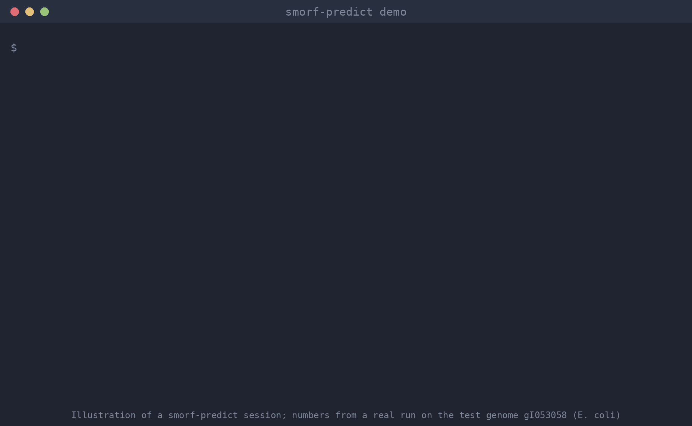

## smORF prediction pipeline

Predict microproteins (small ORFs, ≤100 aa) from bacterial genome FASTA files on the Sanger farm
(LSF, PaM modules, databases on `/data/pam`), from one genome to large screens.

```text
 genome FASTA    one file, a folder of files, or a samplesheet
      ▼
 prepare         safe ids (gU000001, contigs gU000001_c001), chunks of 500 genomes
      ▼
 orf call        Bakta 1.11 · smORFinder 1.0 · GMSC-Mapper 0.1 · your own callers (optional)
      ▼
 merge           one consensus set per genome, translate (code 11), keep ≤100 aa
      ▼
 combine         + orfipy 0.0.4 intergenic smORFs; drop bad sequences; mark partial ORFs
      ▼
 flags           AntiFam (spurious families) · Popcorn (coding potential); nothing removed
      ▼
 results/        smorfs.tsv · smorfs.faa · smorfs.gff3
```
Each stage ends at a checkpoint (`results/qc/<stage>_summary.md`): continue, adjust or stop.

### Set up once
`SMORF` is the pipeline folder. One copy serves all your runs (and a team); runs never write into it.

```bash
git clone https://github.com/yazhinia/smorf_pipeline.git $SMORF   # skip if using a shared team copy
cp $SMORF/conf/site.config.example $SMORF/conf/site.config        # then set the tool paths in it
mkdir -p ~/.claude/skills
ln -s $SMORF/.claude/skills/smorf-predict ~/.claude/skills/smorf-predict
```
`conf/site.config` holds the paths of your site (Python env, orfipy, Popcorn, AntiFam HMM); git
ignores it, so on a team you can copy it from the shared copy. The link makes the `smorf-predict`
skill work in any folder, and `git pull` updates it (without it: `claude --add-dir $SMORF`).

### Run with Claude Code
```bash
cd $PROJECT        # your working folder
claude
```
Ask e.g. *"predict microproteins in ./genomes"*. 


*Illustrated session; the numbers come from a real run on the test genome gI053058 (E. coli).*

Claude inspects the input, agrees the options with you, runs one stage at a time and explains
each checkpoint. You need not watch a running stage: keep talking, or close Claude and later ask
it to check the run. At any checkpoint you can run the rest without stopping.

Every answer is logged in `run_log/decisions.tsv`, which is how the pipeline gets improved.

### Run from the command line
```bash
RUN=$PROJECT/smorf_runs/setA       # one folder per genome set, on /lustre or /data/pam
mkdir -p $RUN
cp $SMORF/.claude/skills/smorf-predict/reference/params_template.yaml $RUN/params.yaml
# set input: (and other options) in $RUN/params.yaml, then:
$SMORF/bin/smorf_launch.sh $RUN prepare    # then call, merge, combine, flags (flags alone runs all)
$SMORF/bin/smorf_status.sh $RUN            # progress
```
`smorf_launch.sh` submits the Nextflow head job with `bsub` and reuses finished tasks. Several
genome sets can run at once, each in its own run folder; never launch two runs in one folder.

### Add a gene caller (optional)
Any tool that reads a genome FASTA and writes a GFF with `CDS` rows can join the merge. Its calls
add smORFs and count toward `support_n`, so results then differ from the published catalog method.

Easiest: ask Claude, e.g. *"also run pyrodigal with a 45 nt minimum gene length"*. 

By hand:
install it with `bin/install_tool.sh`, add an `extra_callers:` entry to `params.yaml` (example in
`params_template.yaml`), then check it with `bin/list_tools.py` and test it on one genome with
`bin/test_caller.sh` before `call`.

### Output
The output files are saved in `results` folder.

| file | content |
|---|---|
| `smorfs.tsv` / `.faa` / `.gff3` | one row per smORF: position, length, `partial`, callers (`tools`, `support_n`), `source`, AntiFam and Popcorn flags, sequence, your sample and contig names |
| `dropped.tsv` | smORFs removed for X, internal stop or odd letters, with the reason |
| `per_genome_summary.tsv` | one row per genome: input stats and smORF counts |
| `genome_map.tsv`, `contig_map.tsv` | pipeline ids → your genome and contig names |
| `chunks/<chunk>/` | per-chunk tables (the only copy for runs over 1,000 genomes) |
| `qc/`, `run_log/` | checkpoint summaries and figures; Nextflow report, timeline and trace |

- `source`: `merged_catalog` = called by a gene finder; `orfipy_novel` = unlabelled intergenic
  ORFs, a discovery pool, mostly not real proteins.
- `partial` other than `none`: one end may be cut off, so the real protein may be longer.
- `$RUN/run_log/decisions.tsv` (next to `results/`) holds every question and answer of the run.
